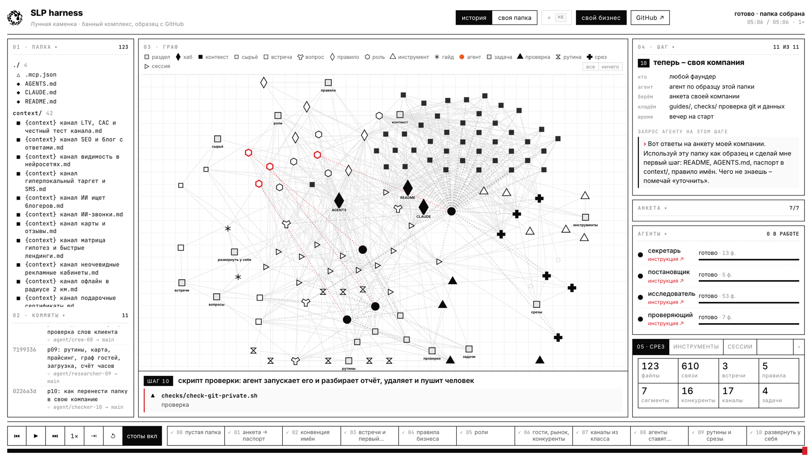

# SLP harness · папка компании

Кит и симулятор к классу SLP'26 «AI for Business», 14 октября 2026. Пример – вымышленный банный комплекс «Лунная каменка» в Москве на 18 человек: будни пустые, отзывы без ответа, договорённости живут в WhatsApp администратора. За десять шагов пустая папка становится системой, которую читают люди и агенты.



**Симулятор:** https://slp-ai-business.lab.aimindset.org/sim/
**Папка компании целиком, с переходами между файлами:** [kit/files/](kit/files/)
**Презентация класса:** https://slp-ai-business.lab.aimindset.org/deck/

## начать за вечер

Пять шагов без программирования. Остановиться можно после любого.

1. **Подписка на агента.** Одной хватит: Claude Pro или Max (claude.ai) – в нём Claude Code; или ChatGPT Plus – в нём Codex.
2. **Агент на компьютер.** Проще всего – приложение Claude для компьютера, вкладка Code, или приложение Codex: там выбирается папка. Из Терминала: `curl -fsSL https://claude.ai/install.sh | bash` для Claude Code, `npm i -g @openai/codex` для Codex.
3. **Папка компании.** Обычная папка, например `~/company`. Положите туда то, что уже есть и что вы готовы отдать модели: вики или регламенты, прайс, выгрузку отзывов, расшифровки двух-трёх встреч. Телефоны и паспортные данные клиентов уберите заранее.
4. **Базовый запрос.** Откройте агента в этой папке и вставьте запрос ниже. Агент сам сходит в этот репозиторий, разложит файлы, задаст вопросы анкеты и соберёт паспорт компании.
5. **Посмотреть, что получилось.** Симулятор → «своя папка» → «выбрать папку» (Chrome, Arc или Edge): граф, поиск, правка файлов. Ничего не ставится, папка никуда не уходит.

Дальше – по десяти шагам ниже, по одному за раз.

### базовый запрос агенту

```text
Сходи в https://github.com/ai-mindset-org/slp-harness и прочитай README, kit/files/AGENTS.md, kit/files/rules/ и kit/files/guides/ – это образец папки компании.
Эта папка – память моей компании. Работай только с её файлами.
1. Посмотри, что уже лежит в папке. Предложи раскладку по разделам образца (context, sources, meetings, rules, people, tasks) и имена по правилу «{тип} описание – дата». Покажи список «было → стало» и подожди моего «да», ничего не удаляй.
2. Если в папке есть расшифровки встреч, прочитай их и положи в meetings/ конспект каждой: решения, кто делает, срок и три рекомендации мне.
3. Задай мне по одному вопросы анкеты из образца и собери из ответов паспорт компании в context/.
4. Напиши AGENTS.md: что агенту можно, чего нельзя, какие данные не трогать.
5. Проверь, стоят ли git и Node.js. Если нет – скажи, как поставить, и подожди меня. Заведи в папке git и делай коммит после каждого шага.
Чего не знаешь – пиши «уточнить». Цифры не придумывай, у каждой цифры источник и дата.
```

### что это и что дальше

Симулятор и граф нужны, чтобы увидеть систему и поиграть с ней. В работе остаются две вещи: место, где лежит информация компании (папка в git: на компьютере, в приватном репозитории на GitHub или на своём сервере), и агент, который знает про эту папку и ходит туда за ответами – Claude Code, Codex или бот в Telegram поверх той же папки. Всё остальное – надстройка над ними.

## одна линия, десять шагов

Шаг 00 – пустая папка, дальше десять шагов. Каждый шаг опирается на предыдущий. Остановиться можно после любого: уже собранное работает само.

| шаг | что появляется | кто делает | агент |
|---|---|---|---|
| 00 · пустая папка | README, AGENTS.md, git | владелец | не нужен |
| 01 · анкета → паспорт | `context/` паспорт, `sources/` разговор с владельцем и сырьё | владелец 15 минут отвечает голосом на семь вопросов | секретарь |
| 02 · имена файлов | `rules/` имена файлов | владелец утверждает | переименовывает |
| 03 · встречи и первый вопрос | `meetings/`, `asks/` | администратор включает запись | секретарь |
| 04 · правила | `rules/` цены, голос, данные | управляющий и владелец | ищет расхождения |
| 05 · роли | `people/` | владелец | раскладывает задачи |
| 06 · гости, рынок, конкуренты | `context/` сегменты, рынок, 16 конкурентов; `tools/` | маркетолог | исследователь через Exa |
| 07 · каналы из класса | `context/` 17 каналов | маркетолог | исследователь |
| 08 · агенты ставят задачи | `tasks/`, `checks/` | управляющий подтверждает | секретарь, постановщик, проверяющий |
| 09 · рутины и срезы | `routines/`, `skills/`, `dashboards/` | управляющий читает срезы | рутины по расписанию |
| 10 · развернуть у себя | `guides/`, проверка git и данных | любой фаундер | по образцу этой папки |

Один вопрос «что мы обещали корпоративному клиенту?» растёт вместе с папкой: после встреч агент отвечает по транскрипту, после правил и ролей называет роль и правило, после рутин показывает задачи со статусом и проверяет слова клиента по рынку.

## зачем каждый шаг

В симуляторе у каждого шага карточка «зачем»: что ломается без этого шага, что он даёт, одна цифра с источником и где взять материал у себя.

| шаг | без этого | цифра |
|---|---|---|
| 00 · пустая папка | контекст компании разбросан по чатам, почте и головам. агенту не за что взяться, и каждый разговор с ним начинается с нуля. | AGENTS.md за полгода подключили больше 60 000 открытых проектов, по данным OpenAI. в декабре 2025 формат передан в фонд при Linux Foundation, его поддерживают OpenAI, Anthropic и Block – [OpenAI, 09.12.2025](https://openai.com/index/agentic-ai-foundation/) |
| 01 · анкета → паспорт | агент додумывает, кто вы. спросите про цену часа – назовёт среднюю по рынку и не предупредит. | Anthropic советует давать модели наименьший набор самых полезных сведений: чем больше текста в контексте, тем хуже модель находит в нём нужное – [Anthropic, Effective context engineering, 29.09.2025](https://www.anthropic.com/engineering/effective-context-engineering-for-ai-agents) |
| 02 · конвенция имён | «Документ (3) финал.docx»: человек ищет глазами, агент открывает файлы подряд и тратит на это внимание. | у Claude Code с первой секунды в контексте только CLAUDE.md, остальное он находит поиском по именам и тексту. по Anthropic, папки, правила имён и даты – важные сигналы для агента – [Anthropic, Effective context engineering, 29.09.2025](https://www.anthropic.com/engineering/effective-context-engineering-for-ai-agents) |
| 03 · встречи и первый вопрос | обещания клиенту живут в памяти администратора и в его WhatsApp. ушёл человек – ушли договорённости. | около 19% рабочего времени сотрудники тратят на поиск и сбор информации – [McKinsey Global Institute, The social economy, 2012](https://www.mckinsey.com/industries/technology-media-and-telecommunications/our-insights/the-social-economy) |
| 04 · правила бизнеса | правило живёт в голове управляющего. без него агент уверенно обещает скидку, и отвечать за неё будет компания. | чат-бот Air Canada пообещал пассажиру возврат, которого нет в правилах. трибунал обязал авиакомпанию заплатить: компания отвечает за всё, что говорит её бот – [Moffatt v. Air Canada, 14.02.2024](https://www.canlii.org/en/bc/bccrt/doc/2024/2024bccrt149/2024bccrt149.html) |
| 05 · роли | «кто решает про скидку?» уходит в общий чат и ждёт ответа до вечера. всё нестандартное приходит к владельцу. | в Юздеске за базу знаний агента отвечает отдельный человек, от неё около 70% качества ответов. у строительной компании без хозяина базы агент через три недели называл старые цены – [generation-ai.ru, кейс Юздеска](https://generation-ai.ru/cases/usedesk) |
| 06 · гости, рынок, конкуренты | агент пересказывает рынок по памяти модели: цифры похожи на правду, источников нет. | Deloitte вернула правительству Австралии часть оплаты по контракту на 440 000 австралийских долларов: в отчёте, подготовленном с Azure OpenAI, нашли выдуманные цитаты и ссылки на несуществующие исследования – [AP, 07.10.2025](https://www.yahoo.com/news/articles/deloitte-partially-refund-australian-government-070855665.html) |
| 07 · каналы из класса | решения о маркетинге принимаются по памяти о последнем звонке, а знания из класса остаются в конспекте. | 74% смотрят отзывы за последние три месяца, 68% рассматривают компании с рейтингом от 4,0 – [ЭГО, опрос, 07.2026](https://egoai.ru/blog/post.php?slug=kak-otzyvy-v-yandeks-kartah-i-2gis-vliyayut-na-prodazhi-issledovanie) |
| 08 · агенты ставят задачи | после встречи все разошлись, задачи помнит тот, кто записывал. через неделю три обещания клиенту висят без ответа. | 58% рабочего дня уходит на работу о работе: статусы, поиск, согласования. опрос 9 615 офисных сотрудников – [Asana, Anatomy of Work 2023](https://www.businesswire.com/news/home/20230308005268/en/Asana-Anatomy-of-Work-Global-Index-2023) |
| 09 · рутины и срезы | агент работает, только когда его попросили. экономию считают на глаз, и глаз ошибается. | в рандомизированном исследовании опытные разработчики с AI работали на 19% медленнее и при этом считали, что на 20% быстрее – [METR, июль 2025](https://metr.org/blog/2025-07-10-early-2025-ai-experienced-os-dev-study/) |
| 10 · развернуть у себя | папка с телефонами гостей уезжает в зарубежную модель или в открытый репозиторий. | с 30 мая 2025 утечка персональных данных стоит юрлицу от 3 млн ₽, повторная – оборотный штраф до 3% выручки – [ст. 13.11 КоАП в редакции 420-ФЗ](https://airassvet.ru/articles/152fz-zarubezhnye-ii) |

## тринадцать общих типов

Типы одинаковые для любой компании и любой группы. Что именно лежит в файле, говорит имя: `{context} конкурент Сандуновские бани.md`, `{context} сегмент пары.md`. Отдельный тип заводится только для главного, чего много.

| тип | папка | что внутри |
|---|---|---|
| контекст | [context/](kit/files/context/) | паспорт, рынок, конкуренты, сегменты гостей, каналы |
| сырьё | [sources/](kit/files/sources/) | выгрузки броней и отзывов без имён и телефонов |
| встреча | [meetings/](kit/files/meetings/) | транскрипты планёрок и звонков |
| вопрос | [asks/](kit/files/asks/) | вопросы к папке и ответы со ссылками |
| правило | [rules/](kit/files/rules/) | правила бизнеса, каждое на одну страницу |
| роль | [people/](kit/files/people/) | кто что решает; четыре агента – тоже роли, у каждого инструкция и промпт |
| инструмент | [tools/](kit/files/tools/) | Exa, транскрибация, бронирование, отзывы, ИИ-администратор |
| задача | [tasks/](kit/files/tasks/) | исполнитель, срок, ссылка на встречу |
| проверка | [checks/](kit/files/checks/) | задачи по правилам, git и приватные данные |
| рутина | [routines/](kit/files/routines/) | что агенты делают по расписанию |
| срез | [dashboards/](kit/files/dashboards/) | карта, прайсинг, граф гостей, загрузка, радар пабликов, счёт часов |
| гайд | [guides/](kit/files/guides/) | как развернуть у себя, закон и данные |
| скилл | [skills/](kit/files/skills/) | навык агента одним файлом: когда запускать, гайд человека, инструмент; Claude Code берёт копию из `.claude/skills/` |

## агенты – это файлы

Четыре агента: секретарь, постановщик, исследователь, проверяющий. Каждый – файл в `people/`, например [агент секретарь](<kit/files/people/{role} агент секретарь.md>): что делает, что читает и пишет, кто принимает работу, чего нельзя, и промпт, который можно вставить в Claude Code или Codex. Правка инструкции – обычная правка файла, видна в git. На графе агент связан со своей инструкцией красным пунктиром, клик по агенту открывает её.

Каждый запуск агента оставляет журнал в [sessions/](kit/files/sessions/): запрос, что прочитал, что создал, ветка и коммит. Агент работает в своей ветке `agent/<роль>-<шаг>`, в main сливает человек:

```
git log --oneline --graph      # ветка агента и слияние на каждом шаге
git show agent/secretary-03    # что именно сделал агент на шаге 03
```

## данные – настоящие

- **16 бань Москвы** с адресами, координатами, ценами, рейтингами и темами отзывов, у каждой цифры источник и дата
- **рынок**: 340 коммерческих бань в Москве и области, средний чек, сезонность, дни недели, тренды, зарплаты: [какой рынок бань в Москве](<kit/files/asks/{ask} какой рынок бань в Москве.md>)
- **17 каналов** из класса SLP про маркетинг с фактами 2026 года и **7 сегментов гостей** с цифрами из опросов – карточки контекста
- **как развернуть у себя**: девять шагов, стек в России с ценами, 152-ФЗ, кейсы: [guides/](kit/files/guides/)

Всё собрано агентом через Exa 8 октября 2026. Цифры меняются – карточки обновляет рутина по понедельникам.

## срезы

У каждого среза один вопрос, один зритель и одна рутина, которая его обновляет.

| срез | на какой вопрос отвечает | кто смотрит | обновляет рутина |
|---|---|---|---|
| [карта конкурентов](https://slp-ai-business.lab.aimindset.org/sim/tools/karta.html) | кто из бань рядом забирает наших гостей и чем он сильнее | владелец, управляющий | конкуренты по понедельникам |
| [прайсинг](https://slp-ai-business.lab.aimindset.org/sim/tools/praising.html) | сколько брать за конкретный слот и где наш прайс против соседей | управляющий | конкуренты по понедельникам, недельный срез |
| [граф гостей](https://slp-ai-business.lab.aimindset.org/sim/tools/gosti.html) | какому сегменту через какой канал и с каким сообщением продавать | маркетолог | исследователь раз в месяц |
| [загрузка](https://slp-ai-business.lab.aimindset.org/sim/tools/zagruzka.html) | какие слоты стоят пустыми и сколько денег недобираем | управляющий | недельный срез |
| [радар пабликов](https://slp-ai-business.lab.aimindset.org/sim/?phase=p09) · в симуляторе на шаге 09 | где разместиться в Москве и с чего начать | маркетолог, владелец | радар пабликов раз в месяц |

Исходники – html-файлы в [dashboards/](kit/files/dashboards/): открываются в браузере прямо из папки.

Как собиралась база конкурентов и чем «Лунная каменка» отличается: [конкуренты и дифференциация](<kit/files/context/{context} конкуренты и дифференциация – 2026-10-14.md>). Какие тулы и скиллы появились на каком шаге: [тулы и скиллы по шагам](<kit/files/guides/{guide} тулы и скиллы по шагам.md>). Термины: [словарь](<kit/files/guides/{guide} словарь терминов.md>). В симуляторе то же самое собрано в окне «как это устроено» (кнопка в шапке, клавиша `?`).

## скиллы

Скилл – навык агента одним файлом в [skills/](kit/files/skills/): когда запускать, как это делает человек, каким инструментом. Повторяющиеся процедуры живут здесь, в правилах остаётся «что можно и что нельзя».

| скилл | отвечает на вопрос |
|---|---|
| [разбор отзывов](kit/files/skills/review-replies/SKILL.md) | что ответить на новые отзывы и какие темы у недели |
| [срез недели](kit/files/skills/weekly-slice/SKILL.md) | что изменилось за неделю: загрузка, отзывы, соседи, часы |
| [цена слота](kit/files/skills/slot-price/SKILL.md) | сколько брать за этот слот и почему |
| [радар пабликов](kit/files/skills/publics-radar/SKILL.md) | где о нас написать и что предложить админу |
| [doctor](kit/files/skills/doctor/SKILL.md) | всё ли в порядке с папкой: имена по правилу, YAML, ссылки, висячие файлы, цифры без источника |

## проверка перед тем, как делиться

```bash
bash checks/check-git-private.sh
```

Смотрит, всё ли закоммичено, есть ли удалённый репозиторий, нет ли в файлах телефонов, почт, ключей, номеров карт и слов из `.private-words`. Если в папке лежит `.local-only`, удалённого репозитория быть не должно. Агент запускает скрипт и разбирает отчёт, удаляет и пушит человек: [git и приватные данные](<kit/files/checks/{check} git и приватные данные.md>).

## своя компания

**Без терминала:** в симуляторе кнопка «свой бизнес» → тип бизнеса или своя анкета → запросы агенту по двенадцати разделам и стартовая папка архивом. Ответы остаются в браузере.

**С терминалом** (нужны git и Node.js 18+):
```bash
git clone https://github.com/ai-mindset-org/slp-harness.git ~/slp-harness   # движок и образец
~/slp-harness/bin/new.sh ~/harness/lunnaya-kamenka                           # папка компании: коммит на шаг, граф на localhost:4747
cd ~/harness/lunnaya-kamenka && claude                                         # агент сам читает AGENTS.md и CLAUDE.md
```
`new.sh` создаёт папку `~/harness/lunnaya-kamenka` с историей из одиннадцати коммитов (пустая папка и по одному на шаг) и открывает её в режиме «своя папка». Существующую папку не перезаписывает: тогда `~/slp-harness/bin/open.sh <папка>`. Или двойной клик по `! Open SLP Harness.command`. В открытом движке кнопка «выбрать папку» показывает окно выбора в `~/harness` и переключает граф на другую папку. Папка открывается в Obsidian как хранилище; ссылки между файлами – обычные markdown, работают на GitHub, в Obsidian и у агентов.

## вторая папка: группа

Та же система подходит группе. Свою папку SLP'26 ведущий собрал за вечер из того, что уже было: анкета трека, интро участников, расписание и разборы классов, записи из Notion. Те же типы, те же четыре агента: секретарь разбирает запись класса, исследователь подбирает гостей под кластеры, постановщик ставит задачи трека, проверяющий сверяет анонс с правилами потока. классы – встречи, участники, гости и кластеры – карточки контекста, правила потока, роли класса, задачи трека. Папка группы SLP'26 хранится только на компьютере ведущего, помечена `.local-only` и в этот репозиторий не входит. Открывается тем же движком: `HARNESS_KIT=slp bin/open.sh <папка группы>`.

## устройство

```
kit/
  answers.json        ответы анкеты: подставляются в {{company}} и другие поля
  manifest.json       шаги 00–10: запрос агенту, «как это работает», карточка шага, сессии и ветки агентов; 4 агента
  files/              папка компании в финальном виде; README в каждом разделе
  files/_assets/      превью конкурентов
  versions/           промежуточные версии: AGENTS.md, ответ на вопрос
tools/                timeline · build-scenario · build-kit · export-tools · harness-server · harness-demo
web/                  симулятор: index.html · app.js · setup.js · styles.css · sections.json · tools/
bin/                  new.sh · open.sh · fork.sh · replay.sh · stop.sh
```

Правка кита: файл в `kit/files/` или шаг в `kit/manifest.json` → `node tools/build-scenario.mjs`.

Движок – форк маркетинг-харнесса AI Mindset: https://github.com/ai-mindset-org/marketing-harness
